# Five Pawns — GDD & Kiến trúc (Giai đoạn 1)

> Đã chốt: **PvE vs Nhà Cái**, **Hành Quyết = Chặt Ngũ Chỉ** (thay súng lục ổ quay), **online ngay từ đầu**, **Godot 4 + GDScript**, **luật và giao diện trong game bằng tiếng Anh**. Mặt bài giữ chữ Hán gốc.
> Các dòng đánh dấu ⚙ là giá trị mặc định mình tự chọn — đổi được mà không ảnh hưởng kiến trúc.

---

## 0. Thuật ngữ trong game (tiếng Anh)

Tài liệu này viết tiếng Việt cho dev. Mọi chữ người chơi thấy dùng cột bên phải.

| Tiếng Việt | Trong game |
|---|---|
| Tướng / Sĩ / Tượng / Xe / Pháo / Mã / Tốt | General / Advisor / Elephant / Chariot / Cannon / Horse / Pawn |
| Đỏ / Đen | Red / Black |
| Lẻ / Đôi / Bộ ba / Tứ tử / Ngũ tử | Single / Pair / Triple / Four Pawns / Five Pawns |
| Màn / Ván / Vòng / Kết | Stage / Hand / Trick / Final |
| Cầm cái / Gọi N lá | Lead / Calls N |
| Nhà Cái / Hình nhân | The House / Effigy |
| Hành Quyết / Thớt / Khung đao | Execution / The Block / The Blade |
| Que ngắn / Que dài | Short Bamboo / Long Stick |
| Đặt Tay Thay | Take the Blade |
| Ngón Út / Áp út / Giữa / Trỏ / Cái | Pinky / Ring / Middle / Index / Thumb |
| Bùa | Charm |

Mặt bài: chữ Hán gốc (đỏ 帥仕相俥炮傌兵, đen 將士象車砲馬卒) cộng vạch khắc chỉ cấp chức. Tên tiếng Anh hiện khi rê chuột.

## 1. Vòng lặp chơi

**Run** = chuỗi các **Màn**. Mỗi Màn là một Nhà Cái (AI) mới. Mỗi Màn gồm nhiều **Ván** Tam Cúc, mỗi ván kết thúc bằng pha **Hành Quyết** cho đúng một người.

| Vai | Ghế | Mạng | Ghi chú |
|---|---|---|---|
| Nhà Cái | luôn ghế 0 | 5 ngón | AI. Cầm cái ván đầu tiên của Màn. Debuff mất ngón làm AI chơi kém đi. |
| Người chơi | ghế 1–3 | 5 ngón | 1–3 người thật, chung một phe. |
| Hình nhân (bot) | ghế trống | không | Lấp ghế để bàn luôn đủ 4. Đánh bài như bot thường nhưng **không bao giờ lên thớt**. Người chơi bị Trảm Quyết thì ghế đó thành Hình nhân. |

- **Thắng Màn:** Nhà Cái mất ngón Cái → sang Màn sau (Nhà Cái khó hơn).
- **Thua Run:** tất cả người thật bị Trảm Quyết.
- Mỗi lần mất ngón để lại vết máu và vết sẹo trên thớt/mặt bàn **trong suốt phiên chơi** (không lưu ra đĩa).

## 2. Luật Tam Cúc (đặc tả cho engine)

**Bộ bài 32 lá**, mỗi màu 16 lá: Tướng ×1, Sĩ ×2, Tượng ×2, Xe ×2, Pháo ×2, Mã ×2, Tốt ×5.
Thứ tự: Tướng > Sĩ > Tượng > Xe > Pháo > Mã > Tốt. Cùng chức thì Đỏ > Đen.

**Bộ hợp lệ**

| Loại | Số lá | Điều kiện | So sánh |
|---|---|---|---|
| Lẻ | 1 | bất kỳ | chức, rồi màu |
| Đôi | 2 | cùng chức, cùng màu, không phải Tướng | chức, rồi màu |
| Bộ ba | 3 | Tướng-Sĩ-Tượng hoặc Xe-Pháo-Mã, cùng màu | TST > XPM, rồi màu |
| Tứ tử | 4 | 4 Tốt cùng màu | màu |
| Ngũ tử | 5 | 5 Tốt cùng màu | màu |

**Một vòng (trick)**
1. Người cầm cái **đặt úp** một bộ hợp lệ có N lá (N ∈ 1–5) và công bố N.
2. Ba người còn lại mỗi người **đặt úp đúng N lá** bất kỳ, theo **thứ tự nào cũng được**: online thì ai chọn xong trước úp trước. Không ai thấy bài người khác cho tới khi lật. Thứ tự chiều kim đồng hồ chỉ dùng để xử hòa (bước 4).
3. Lật cùng lúc. Một bộ chỉ **ăn được** nếu cùng loại với bộ cầm cái và **mạnh hơn hẳn** bộ đang dẫn. Mọi bộ khác là bài rác.
4. ⚙ **Hòa** (ví dụ hai lá Sĩ Đỏ) → người đặt **trước** thắng.
5. Người ăn vòng cầm cái vòng sau.

**Ván:** mỗi người 8 lá, chơi tới khi hết bài. Vòng cuối cùng gọi là **Kết**. Người ăn Kết cầm cái ván sau.
⚙ Tứ/Ngũ tử chỉ đánh được khi mình cầm cái. Không có luật cướp cái ngoài lượt, để engine giữ đúng một luồng.

## 3. Hành Quyết: Chặt Ngũ Chỉ

Tên game có hai nghĩa: **5 quân Tốt** trên bàn và **5 ngón tay** cầm bài.

### 3.1. Ai lên thớt và bao nhiêu que ngắn (engine đã làm: `TamCucGame._score`)

**Người lên thớt:** đúng một người mỗi ván. Lấy trong các ghế còn mạng (Nhà Cái + người thật), trừ người ăn Kết:
1. người ăn **ít vòng nhất**;
2. hòa thì người có lần ăn vòng gần nhất **xa nhất** (chưa ăn vòng nào xếp trước);
3. vẫn hòa thì người ngồi **sát sau** người ăn Kết theo chiều kim đồng hồ.

**Số que ngắn X** (trên 6 que) = `clamp(loss_count, 1, 5)`, với `loss_count` là số lần người đó đã lên thớt, tính cả lần này
(người thật: cả Run; Nhà Cái: trong Màn, Nhà Cái mới về 0). Công thức nằm riêng ở `TamCucGame.compute_short_stick_count(victim_state, hand_result)`;
`hand_result` đã có `ket_type` và `overtaken` nếu muốn cộng thêm hệ số Kết.
⚙ Bảng X theo Kết cũ (1 mặc định, 2 bị đè ở Kết, 3 Đôi/Bộ ba, 4 Tứ tử, 5 Ngũ tử) đã thay bằng công thức trên từ khi chuyển sang rút que.

### 3.2. Rút que, rồi mới chặt

- Nắm tay gỗ của Nhà Cái kẹp **6 que tre**, đầu que lộ ra bằng nhau. Engine xáo bí mật X que ngắn trong 6 que; client không biết que nào.
- Người lên thớt rút **1 que** (bấm chọn rồi bấm PULL STICK, hoặc kéo thẳng que xuống quá 65% đường kéo).
- **Que dài:** trượt ra hết, đầu mộc. Tha, sang ván sau.
- **Que ngắn:** mới kéo được khoảng 1/3 đã tuột ra, đầu vát đẫm máu. Nắm tay rút lên, người đó **chọn 1 ngón** (bấm thẳng lên ngón hoặc trên bảng), dao phay sập xuống, mất ngón đó, áp debuff vĩnh viễn.
- ⚙ Ngón Cái chỉ được chọn khi 4 ngón kia đã mất. Bấm ngón Cái sớm thì ngón rung và hiện dòng luật.
- Nhà Cái tự rút sau 0,8 giây; trúng que ngắn thì hy sinh ngón Út trước, ngón Cái sau cùng.

### 3.3. Debuff theo ngón (vĩnh viễn trong Run)

| Ngón | Mất thì |
|---|---|
| Út | −1 ô Bùa |
| Áp út | Không tự xếp bài trên tay |
| Giữa | Không xem lại lịch sử các lá đã đánh |
| Trỏ | Bài trên tay rung nhẹ; không ping bài cho đồng đội |
| Cái | Trảm Quyết (bị loại) |

Debuff giả định game có các tính năng: ô Bùa, tự xếp bài, lịch sử lá đã đánh, ping. Phải làm các tính năng này trước thì mất ngón mới có ý nghĩa.
Giai đoạn 4 mới áp được: **Áp út** (bài chia ra không tự xếp), **Trỏ** (bài trên tay rung), **Cái** (bị loại). Út và Giữa chỉ hiện chữ, vì game chưa có ô Bùa và lịch sử lá đã đánh. Debuff của Nhà Cái chờ bot thật ở Giai đoạn 5. Với Nhà Cái, debuff tương ứng làm AI kém đi (mất ngón Giữa thì quên các lá đã ra).

### 3.4. Co-op

- **Take the Blade:** khi người lên thớt chỉ còn **1–2 ngón**, một đồng đội còn **nhiều ngón hơn** có thể bấm nhận thay trong **5 giây**, trước khi rút que. Đồng đội đó rút que và nếu trúng que ngắn thì mất ngón của mình; X giữ nguyên. (Chưa làm: chờ co-op ở Giai đoạn 5.)
- ⚙ Bùa can thiệp (ví dụ Incense hiện khói quanh 1 que dài) để sau. Engine chỉ chừa chỗ cho action.

### 3.5. Hình ảnh & cảm giác

- Thớt, nắm tay gỗ, que, dao phay, bàn tay là tranh khắc gỗ (assets/execution/raw/ → tools/execution_art.py). Không dùng 3D tả thực.
- Nền xoáy chuyển đỏ thẫm, **tốc độ xoáy tỷ lệ với X**. Rê chuột lên que: que rung, vignette và chromatic aberration tăng, nhịp tim dồn dần (âm thanh).
- Dao chặt: hitstop 100ms → flash đỏ/trắng 1 frame → screen shake → CRT glitch. Máu pixel văng lên kính CRT rồi chảy xuống (tạm thời). Vết máu và sẹo trên thớt/bàn ở lại cả phiên. Bàn tay cầm bài ở các ván sau hiện ngón đã mất quấn băng thấm máu.

## 4. State Machine

```mermaid
stateDiagram-v2
    [*] --> Lobby
    Lobby --> Deal: đủ người / lấp Hình nhân
    Deal --> Lead: chia 8 lá, seed RNG
    Lead --> Follow: cầm cái đặt úp N lá
    Follow --> Reveal: đủ 4 bộ úp
    Reveal --> Resolve
    Resolve --> Lead: còn bài
    Resolve --> ExecutionEnter: hết bài (vòng này là Kết); chọn người lên thớt + X
    ExecutionEnter --> CoopIntervene: người lên thớt còn 1–2 ngón và có đồng đội nhiều ngón hơn
    ExecutionEnter --> DrawStick: không ai đủ điều kiện nhận thay
    CoopIntervene --> DrawStick: hết 5 giây / có người nhận thay
    DrawStick --> RevealStick: server trả short
    RevealStick --> Deal: que dài (tha)
    RevealStick --> SelectFinger: que ngắn
    SelectFinger --> Chop
    Chop --> ApplyDebuff
    ApplyDebuff --> Deal: còn sống cả hai phe
    ApplyDebuff --> StageWon: Nhà Cái mất ngón Cái
    ApplyDebuff --> RunLost: mọi người thật bị Trảm Quyết
    StageWon --> Deal: Màn mới
    RunLost --> [*]
```



Engine: phase `EXECUTION` = chờ rút que, `CHOP` = trúng que ngắn, chờ chọn ngón.

Engine là một hàm thuần: `apply(state, action) -> Array[Event]`.
- **Action** (do người hoặc bot gửi lên): `Lead(seat, cards)`, `Follow(seat, cards)`, `TakeBlade(seat)` (chưa làm), `DrawStick(seat, stick)`, `Chop(seat, finger)`.
- **Event** (engine phát ra): `Dealt`, `Committed(seat, n)`, `Revealed(...)`, `HandOver(execution = {seat, lethal})`, `StickDrawn(stick, short, sticks)`, `Chopped(seat, finger)`, `Eliminated`, `StageCleared`, `RunOver`.
- Mọi ngẫu nhiên (chia bài, xáo que) đi qua một `RandomNumberGenerator` có seed nằm **trong state**. Cùng seed và cùng chuỗi action luôn ra cùng kết quả, nên replay và unit test được.
- **Chống gian lận:** 6 que sinh và giữ trên server. Client chỉ gửi `stick`; server trả `short` (và lật cả 6 que) cùng trạng thái ngón tay mới cho cả phòng. Kéo que bằng chuột tự chốt trước điểm que ngắn tuột ra, nên client không cần biết trước kết quả.

## 5. Kiến trúc mạng (online từ đầu, một luồng code duy nhất)

```
 Client (người)                       Server (authoritative)
 ┌────────────┐  rpc action    ┌──────────────────────────────┐
 │ Presentation│ ─────────────▶ │ net/server.gd                │
 │  (scenes)   │                │   validate → core.apply()    │
 │             │ ◀───────────── │   bots: chọn action từ View  │
 └────────────┘  rpc events     │   gửi view_for(seat) riêng   │
   chỉ nhận View của ghế mình    └──────────────────────────────┘
```

- **Offline = online với server chạy cục bộ.** Dùng `OfflineMultiplayerPeer` của Godot nên offline đi đúng đường RPC như online, không có nhánh code riêng.
- **Online:** host làm listen-server (`ENetMultiplayerPeer` cho desktop, `WebSocketMultiplayerPeer` nếu sau này xuất bản web). Cùng project đó chạy được dedicated với `--headless`.
- **Chống gian lận:** server chỉ gửi `view_for(seat)`: bài trên tay mình, số lá người khác đã úp, và bài **sau khi lật**. Client không bao giờ nhận seed, bài tay người khác hay vị trí que ngắn.
- **Bot chạy trên server và chỉ đọc `view_for(seat)`**, giống hệt người, nên không bot nào gian lận được. Bot cấp 2 (đếm bài) tự ghi nhớ các bài đã lật.

## 6. Cấu trúc thư mục

```
Five Pawns/
├── project.godot          # 1920×1080, stretch canvas_items, main = game/title.tscn
├── core/                  # logic thuần, extends RefCounted, KHÔNG dùng Node
│   ├── card.gd            # lá bài = int 0..31; chức, màu
│   ├── combo.gd           # validator + so sánh bộ
│   └── game.gd            # TamCucGame: state + apply(action) -> events + view_for(seat); ngón, 6 que bí mật, số lần thua, Màn
├── ai/bot_basic.gd        # bot tạm (G3): cầm cái ra bộ mạnh nhất, theo thì đổ yếu nhất; lên thớt thì rút que bừa, chặt ngón Út trước; chỉ đọc view_for
├── game/                  # hiển thị (G3)
│   ├── match_controller.gd # giữ engine + cho bot đánh; màn hình chỉ submit()/nghe event (G5 thay bằng bản mạng)
│   ├── title.gd/.tscn     # màn tiêu đề
│   ├── table.gd/.tscn     # bàn chơi: hàng đợi sự kiện → hoạt cảnh, chọn/kéo bài, juice, vết máu trên bàn
│   ├── execution.gd       # Hành Quyết: rút que từ nắm tay gỗ, chọn ngón (Area2D), dao phay chặt, máu thấm thớt; các lớp Sprite2D
│   ├── card_view.gd       # lá bài: lò xo, nghiêng 3D, nhấc, kéo, lật
│   └── card_names.gd      # tên tiếng Anh của lá/bộ
├── shaders/               # card_tilt, crt, swirl
├── assets/
│   ├── cards/png/         # 14 mặt + back.png (định dạng phát hành), cards/*.svg là nguồn dựng
│   ├── execution/         # lớp PNG cảnh Hành Quyết + hand_layout.json; raw/ là tranh gốc (.gdignore, không vào bản build)
│   ├── fonts/             # Bevan, VT323 (OFL)
│   └── ref/               # ảnh art direction
├── tools/build_card.py    # dựng lá bài từ ảnh art direction (vtracer)
├── tools/execution_art.py # tách nền tranh gốc Hành Quyết, cắt que, cắt bàn tay thành lòng bàn tay + 5 ngón lành/băng
├── mockups/               # HTML tĩnh để chốt hướng hình ảnh (không dùng trong game)
├── tests/run_tests.gd     # godot --headless --path . -s tests/run_tests.gd
├── tests/debug_execution.tscn # mở trong editor, F6: vào thẳng Hành Quyết; F1 bật bảng debug
└── docs/GDD.md
```

Chạy game: mở `project.godot` bằng Godot 4.7 rồi F5. Tự chơi một ván và chụp màn: `godot --path . -- --shot=<thư mục>`.

## 7. Rủi ro cần biết

1. **NAT:** listen-server qua Internet thường cần mở port. Khi test thì dùng LAN hoặc IP trực tiếp. Bản phát hành cần relay (Steam Networking hoặc một server headless trên VPS). Quyết định ở Giai đoạn 5.
2. **Kết bằng Tứ/Ngũ tử** chỉ xảy ra khi người cầm cái giữ đúng 4–5 Tốt cuối. Hiếm gặp, nên AI Nhà Cái cần cố ý nhắm tới thì mới tạo được khoảnh khắc "Five Pawns".
3. **Cân bằng que ngắn** (`clamp(loss_count, 1, 5)`, 5 ngón cho cả hai phe) mới chỉ là phỏng đoán. Phải playtest.
4. **Debuff phụ thuộc tính năng chưa có** (ô Bùa, tự xếp bài, lịch sử, ping). Chúng phải có trong Giai đoạn 3–5 thì mất ngón mới có hậu quả.
